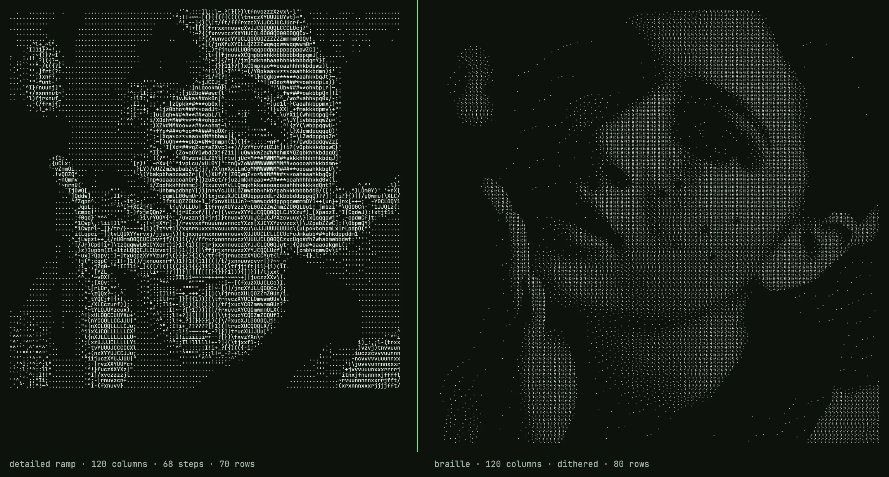
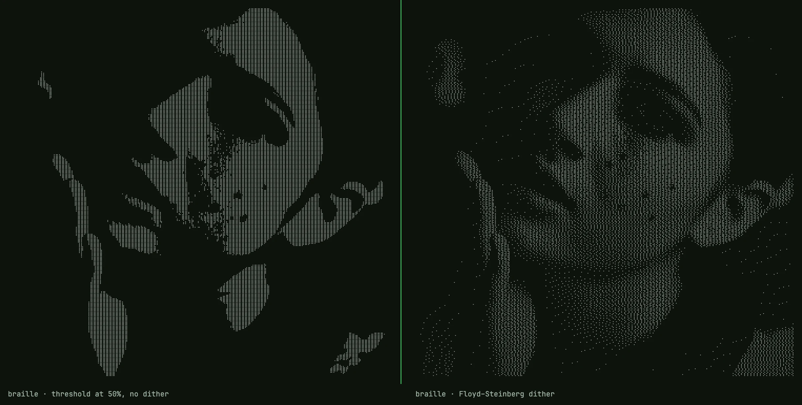
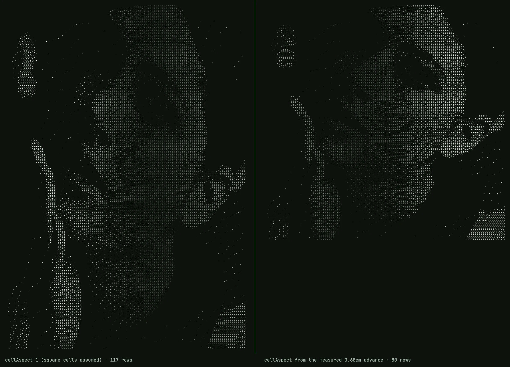

*对照 [`src/ascii-engine.ts`](https://github.com/can4hou6joeng4/Semaphore/blob/main/src/ascii-engine.ts) 在提交 46a5f63（该文件最后一次改动）时的内容逐行核对写成；代码块除另行标明外均按原文引用。配图用已发布的引擎和字体、在 macOS 上的 Chrome 152 里渲染。*

---

我做了一个在浏览器里把图片转成文本的转换器。其中大部分并不特别。下面是后来发现真正有意思的那一段。

传统 ASCII 艺术有一个分辨率问题，把字符坡道加长也解决不了。一个文本格子变成一个字符，这个字符必须承担格子所覆盖区域的全部亮度。`` .:-=+*#%@`` 这种十级坡道给你十个灰阶，六十八级坡道给你六十八个。无论哪一种，*空间*分辨率都是每个格子一个采样；一张脸排到 120 列，就只有 120 个采样宽。结果像一张 120 像素的缩略图被拉到全屏：调子大致对，边缘没了。

盲文解决的是空间问题，不是调子问题。

（严格说这不是 ASCII，盲文是 Unicode，只是这个门类一直沿用了这个名字。）

## 一个其实是位图的字符

Unicode 区段 U+2800 到 U+28FF 有 256 个字符。这不是巧合。每一个都是 2 列 4 行的点阵，每一种开关组合都有自己的码位。八点，每点两种状态，2^8 = 256 种图案。一个盲文字符就是一张可以贴进文本框的 8 像素位图。

Unicode 把点编号为 1 到 8，点 *n* 设置的是相对 U+2800 偏移量的第 *n−1* 位：

```
1 4        ⠁ ⠈
2 5        ⠂ ⠐
3 6        ⠄ ⠠
7 8        ⡀ ⢀
```

这个顺序很怪：7 和 8 排在 3 和 6 下面，而不是顺着列继续往下。原因是历史的。六点盲文在先，最下面一行是后来为计算机盲文补上的。在代码里它就是一张按 `[行][列]` 索引的表：

```ts
const BITS = [[0x01, 0x08], [0x02, 0x10], [0x04, 0x20], [0x40, 0x80]];
```

要输出一个字符，就读取八个亮度值，各自做阈值判断，把对应的位 OR 进 `0x2800`，再调用 `String.fromCharCode`。去掉颜色处理之后，整个打包过程是：

```ts
for (let r = 0; r < rows; r++) {
  let line = "";
  for (let q = 0; q < cols; q++) {
    let code = 0x2800;
    for (let dy = 0; dy < 4; dy++) {
      for (let dx = 0; dx < 2; dx++) {
        const gx = q * 2 + dx, gy = r * 4 + dy;
        const gi = gy * gw + gx;
        if (grid.lum[gi] >= 128) code |= BITS[dy][dx];
      }
    }
    line += String.fromCharCode(code);
  }
  lines[r] = line;
}
```

这些都不是新做法。drawille 在 2014 年就这么做了；chafa、notcurses 和 btop 也在同一张网格上画图。后面要说的，是这些工具的 README 通常跳过的部分：为什么朴素版本看起来很差，以及修正实际做了什么。

## 这张网格换来什么，又付出什么

*C* 列、*R* 行时，坡道字符集在图像上取 *C × R* 个样点。盲文取的是 *2C × 4R*：字符数量相同，采样多八倍，输出仍然是纯文本。120 列就是横向 240 个采样。脸能保住眼窝，标志里的字母也能认出来。



*同一张源图，120 列。左：`detailed` 坡道，68 级。右：盲文，已做误差扩散。两边都是纯文本；右边的采样数是左边的八倍。*

代价在调子上。每个点只有开或关，盲文字符没有中间灰的概念。把平滑渐变在 50% 处一刀切开，跨过中点的地方就是一条硬边，一边纯黑，一边纯白。比阈值暗的像素变成 0，比阈值亮的变成 1，*暗了多少*这件事情消失了。



*同一张照片，同一张网格。左：每个采样都按 50% 取阈值。右：Floyd–Steinberg。右边才是这篇文章要讲的。*

## 误差扩散

Floyd 和 Steinberg 在 1976 年发表的办法，针对的就是这种情况：设备只能打一个点或者不打点，却要表现出连续调子。

从左到右、从上到下走过每个像素。到一个像素，就把它吸到最近的可表示值，也就是 0 或 255，并算出刚刚产生的误差。不要丢掉这个误差，按固定比例推给还没访问过的邻居：

```
          [ X ]  7/16
   3/16   5/16   1/16
```

这些十六分之一加起来是 1，所以亮度没有被制造，也没有被销毁，只是被挪走了。一块 30% 灰的区域，最后大约有 30% 的点是亮的。离得够远时，这种疏密会被看成灰色。凑近了，它就是点阵纹理。盲文字形本身就是点，点与点之间还有空隙，而读者通常就在这个距离上看。这是这种方法诚实的限度，不是实现上的缺陷。

下面这个函数按原文引用，作用在一块存亮度的 `Float32Array` 上：

```ts
function ditherFS(lum: Float32Array, w: number, h: number): void {
  for (let y = 0; y < h; y++) {
    for (let x = 0; x < w; x++) {
      const i = y * w + x;
      const oldv = lum[i];
      const newv = oldv < 128 ? 0 : 255;
      const err = oldv - newv;
      lum[i] = newv;
      if (x + 1 < w)            lum[i + 1]     += err * 7 / 16;
      if (y + 1 < h) {
        if (x > 0)              lum[i + w - 1] += err * 3 / 16;
                                lum[i + w]     += err * 5 / 16;
        if (x + 1 < w)          lum[i + w + 1] += err * 1 / 16;
      }
    }
  }
}
```

有两件事比这些系数更重要。

**它跑在点的网格上，不是字符的网格上。** 亮度数组的尺寸是 2C × 4R。误差扩散发生在任何一个点被打包进字符之前，所以字符边界对它是不可见的：误差可以从一个格子右下角的点，自由流到下一个格子左上角的点。反过来做，先在 C × R 上扩散再放大，每个格子就会整格八个点全开或全关。那只是披着盲文外衣的两级坡道。第二种前后对比图的左右差别，就来自这一个顺序决定。

**它是浮点数组，不是字节。** 亮度在扩散开始之前就是分数（它是三个整数的加权和），向前推送的误差也经常在循环走到某个格子之前，就把该格子推过 255 或低于 0。如果每一步都夹紧成字节，高光和阴影里的误差会被丢掉，那些区域的调子会漂。数组是就地修改的；用第二块缓冲区也可以，这样只是更简单。

为什么用 Floyd–Steinberg，而不用 Atkinson 或蓝噪声蒙版？因为在这种点密度下，经典的 50% 灰「蠕虫」伪影小于一个字符格子，大多会消失在字形空隙里；而且 FS 保持总亮度，Atkinson 则故意丢掉大约四分之一。除了目测，我没有进一步测量这个判断。它是默认选择，不是一项实验结果。

## 管线的顺序

1. 把源图画到一块恰好为 2C × 4R 像素的 canvas 上。浏览器自己的缩小器负责重采样，并设置 `imageSmoothingQuality = "high"`。从 4000 像素的源图画进 480 像素的画布，这一步已经在做实事，别名问题没有再额外处理。
2. 一次 `getImageData`。对每个像素：按通道做亮度和对比度调整，然后算亮度，然后反相。（代码里反相发生在算出亮度之后；因为权重之和恰好是 1，两种顺序结果相同。）
3. 对整张网格调用 `ditherFS`。这一步可以关掉，工具提供了开关，但默认打开。
4. 打包：每个格子八个点，`>= 128` 就点亮。扩散之后每个格子已经恰好是 0 或 255，所以这个比较只在关掉扩散时才真正做决定。

三次完整地走过类型化数组，一次画到 canvas，一次读回。全部发生在当前标签页里。这里没有服务器步骤，因为没有哪一步会因为放到服务器上而更好。

## 亮度，以及伽马这个问题

把 RGB 收成一个数要用加权和，因为眼睛对绿色远比对蓝色敏感：

```ts
L = 0.2126 * r + 0.7152 * g + 0.0722 * bl;
```

这是 Rec. 709 的系数。用错了，例如不加权的平均，饱和的蓝会显得太亮，绿会显得太暗，输出里看得到。

接下来是色彩科学会提出的异议。canvas 给出的值是 sRGB 编码、经过伽马压缩的。Rec. 709 用这组权重定义了两个量：线性光上的*亮度* Y，以及伽马编码分量上的*亮度信号* Y′。这段代码算的是 Y′。这是一个标准量，电视实际传输的就是它，但它不是一个像素在物理上正确的亮度。中性灰上两者完全一致。饱和色上 Y′ 会低估，所以一块颜色很浓的区域会比应有的稍暗一点。

我没有测量这对这种分辨率下的 1 比特误差扩散输出有多大影响。正确的做法是把每个通道线性化、加权、再编码回去，大约十行。我没有把它发布出去，因为我还没有在真实图像上看出差别。如果有人贴出能看出差别的对比，我会换过去。

## 格子不是正方形

等宽格子的高大于宽。行高为 1 时大约是宽 3、高 5，具体还随字体变化。行数必须把这一点算进去：

```ts
const rows = Math.max(1, Math.round((rect.sh / rect.sw) * cols / aspect));
```

当 `aspect = 1/0.6` 时，一张正方形图像在 120 列下会得到 72 行，而不是 120 行。漏掉这一步，每张脸都会在垂直方向被拉长三分之二。这是我在自制转换器里见过的最常见缺陷。

它也回到标题上的那句话。把一个 3:5 的格子分成 2 × 4，每个点覆盖格子的 0.30 × 0.25，非常接近正方形。这就是盲文能够当作像素来用的原因。同一个格子如果分成 1 × 2，就做不到。



*同一张源图，120 列。左：`cellAspect: 1`，把格子当成正方形，117 行。右：宽高比来自测得的盲文后备字体进宽，80 行。*

`aspect` 从哪来？在已发布的工具里，它不是一个常数。站点其他地方用的 JetBrains Mono 在 256 个盲文字形里一个都没有。我查过字体的 cmap。Menlo 也没有。于是盲文会落到操作系统提供的某个后备字体上，而那个字体的格子宽度并不是主字体的宽度。所以页面自己测量：在一个隐藏的 span 里、以 100px 放五十个 `⣿`，用宽度除以 5000。行数和适配后的字号都从这一个数推导。在我打这篇文章的这台 Mac 上（Chrome 152，后备字体是 Apple Braille），测得 0.684em，不是 0.60。因此那张 1100×1069 的样例肖像在 120 列下是 80 行，而不是 70 行。引擎只指出要测量哪个字形；测量是页面做的。什么都不传、直接调用引擎时，得到的才是 `1/0.6`。

在 README 或聊天窗口里，你得听渲染器的。所以盲文是细节最高的选项，而不是默认选项。如果你要一个文本框所能承载的最多细节，就是它。如果你要输出在任何地方都还像样，`` .:-=+*#%@`` 仍然是稳妥的选择。知道自己要的是哪一种，就是这门手艺的大部分。

---

*转换器在 [semaphore.bobochang.cn](https://semaphore.bobochang.cn/)；源码以 MIT 许可放在 GitHub，引擎是一个文件，`src/ascii-engine.ts`。[盲文字符集页面](https://semaphore.bobochang.cn/charsets/braille)会把上面这条管线当场渲染出来。*

---
